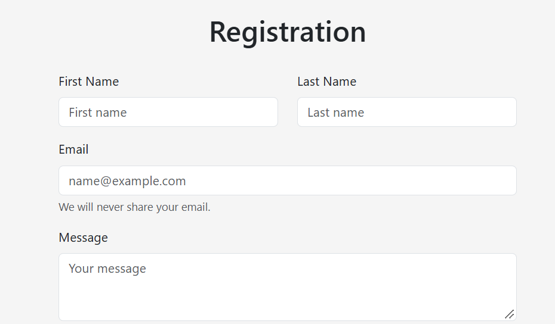
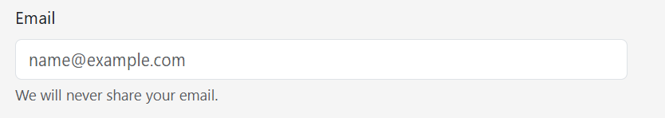
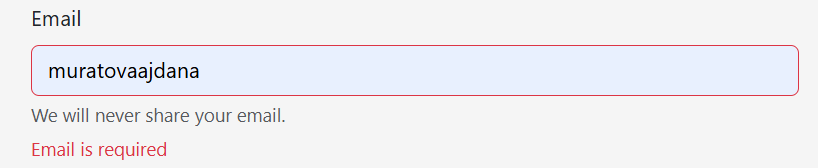
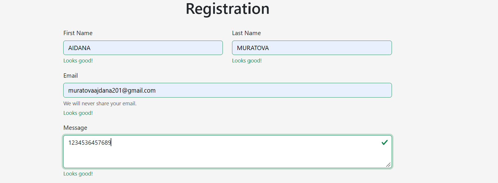
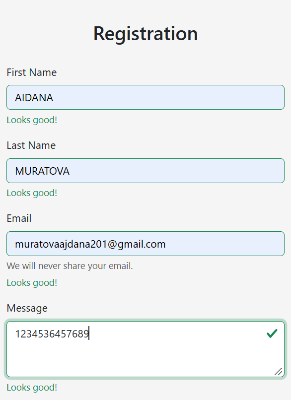
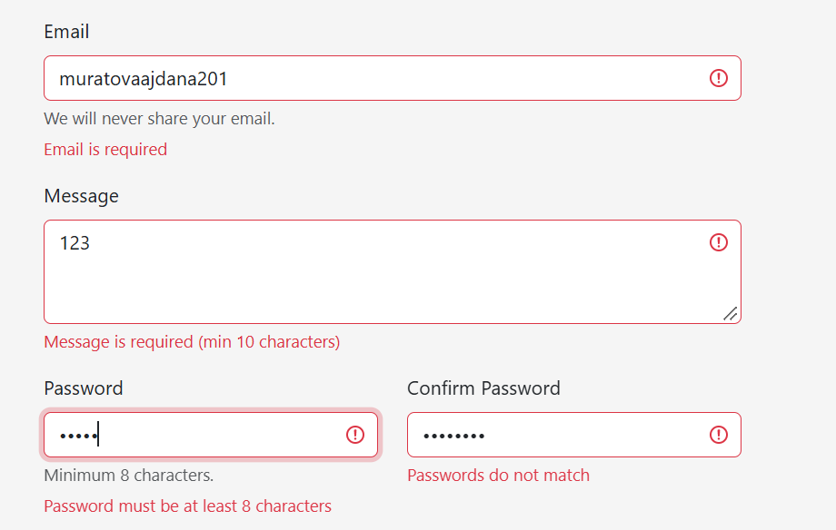
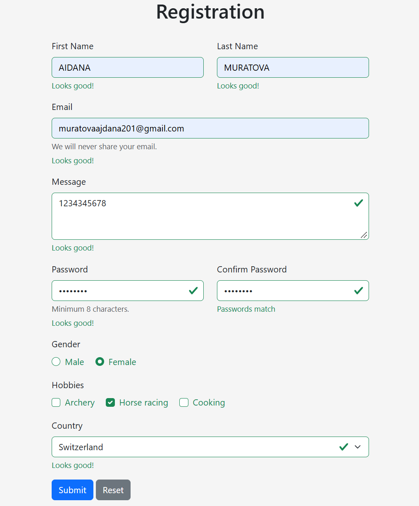
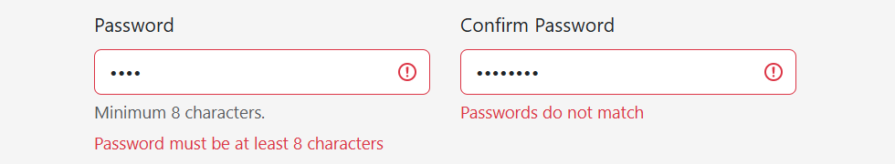
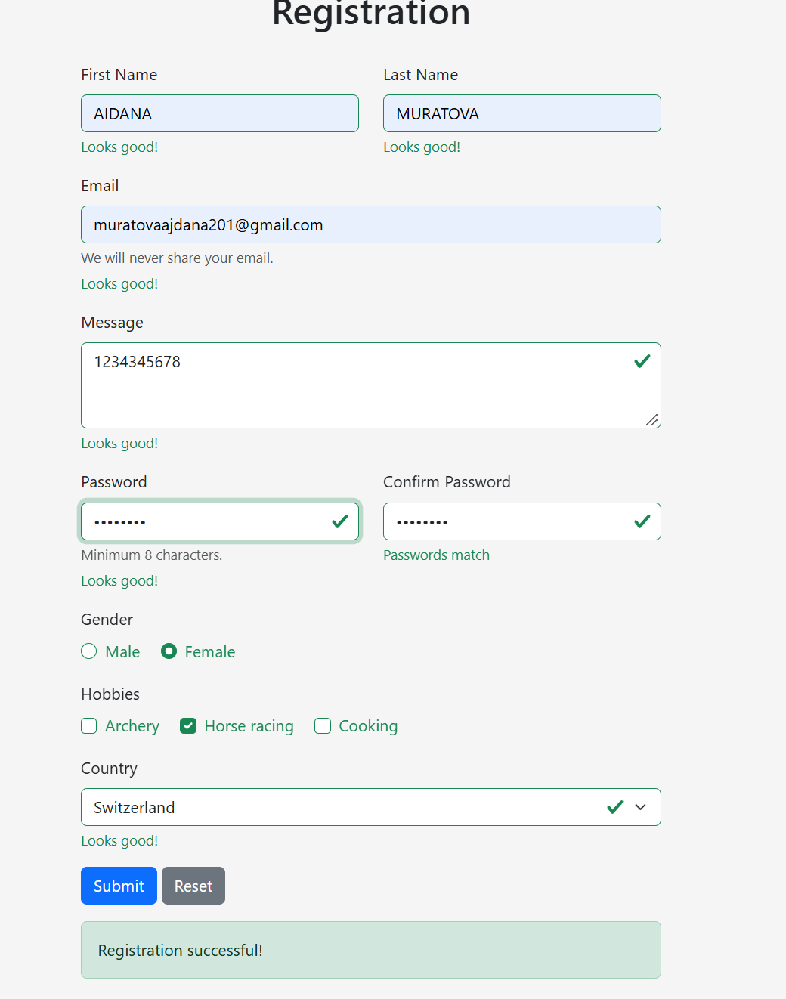
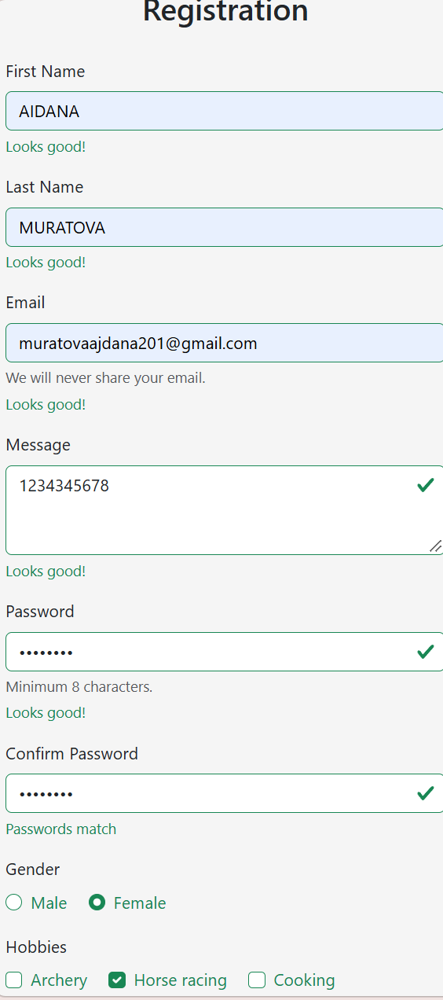

# Assignment 4. Forms and Validation

Name: Aidana Muratova

Link:
## Introduction

In this assignment I learned how to make forms in HTML, how to style them with Bootstrap and how to check the data that a user writes in them. I made one registration form in index.html. In style.css I wrote a few small styles of my own. Bootstrap 5 is connected with a CDN link, so I did not download anything.

Before this assignment I thought that a form is just some inputs and a button. Now I understand that a good form also needs labels, rules for the data, error messages and a layout that works on a phone.

## Part 1. Basic HTML Forms

### Task 0. Simple Contact Form

In this task I had to make a basic contact form with Name, Email, Message and a Submit button. Every field must have a label.

I put all the fields inside the form tag. The form is like a box for the fields, and the Submit button sends the data from this box. For each field I wrote a label and an input.

The thing I understood here is how the label and the input are connected. In the label I write for="email" and in the input I write id="email". These two values must be the same. When they are the same, a click on the word Email puts the cursor in the field. It is also better for people who use screen readers.

The fields have different types. For the name I used type="text", it is a simple text field. For the email I used type="email", so the browser knows that there should be an email address. For the message I used a textarea, because it is a big field for many lines, and I set its height with rows. For the button I used type="submit".

### Task 1. Form with HTML5 Validation

In this task I had to add the built-in validation attributes and check how the browser works with them.

Validation means that the data is checked before the form is sent. HTML5 can do it only with attributes, without JavaScript. I used required, so the field cannot be empty. I used type="email", so the browser checks that the text looks like an email, with @ and a domain. I used minlength and maxlength to control how many characters the user can write. For example the name must have at least 2 characters, and the message must have from 10 to 200.

To test it, I first pressed Submit with empty fields, and the browser did not send the form and told me that the field is required. Then I wrote an email without @ and the browser did not accept it too. I also tried a name with only one letter.

I noticed that the text of the error is made by the browser, and it depends on the language of the browser. I cannot change how this message looks with CSS. This is one of the reasons why we use Bootstrap validation in the next part.

## Part 2. Bootstrap Forms

### Task 2. Bootstrap Form Styling

In this task I made the contact form again, but with Bootstrap classes. I also had to use the grid, placeholders and helper text.

Bootstrap is a set of ready CSS classes. I do not write long CSS, I just add classes to the HTML tags. The CSS file is connected in the head, and the JS file is at the end of the body. I also added the meta viewport tag, because without it the page looks wrong on phones.

The classes I used are form-label for the labels, form-control for inputs and textarea, form-select for the dropdown, form-check for radio buttons and checkboxes, and btn btn-primary for the button. For the space between the fields I used mb-3, which is a margin at the bottom.

About the grid. Bootstrap divides the row into 12 columns, and the structure is container, then row, then col. For First Name and Last Name I used col-12 col-md-6. It means that on a small screen like a phone each field takes all 12 columns, so they are one under another. From medium screens (768px) each field takes 6 columns, so they are side by side. Bootstrap is mobile first, so the small screen is the default and md is the change for bigger screens.

The placeholder is the gray text inside an empty input, and it disappears when I start writing. The helper text is a small text under the input, I made it with div class="form-text". For example, under the password I wrote that the minimum is 8 characters.

### Task 3. Bootstrap Validation Styles

In this task I used the Bootstrap classes for validation and showed the messages under the inputs.

With Bootstrap validation the input becomes green when the data is correct and red when it is wrong, and a message appears under it. Under every input I wrote two divs. One is valid-feedback with the text Looks good!, and the other is invalid-feedback with the error, for example Email is required. Only one of them is visible at the same time.

The classes is-valid and is-invalid can be written by hand, but it is not useful in a real form, because the user writes the data and the state changes. So I used a small script that does it automatically.

The form has the class needs-validation and the attribute novalidate. The novalidate turns off the messages of the browser from Task 1, so only the Bootstrap style is shown. The first time I forgot it, and I saw the browser messages instead of the Bootstrap ones.

The script works like this. It finds the form by id, then it waits for the submit event. Inside it checks form.checkValidity(), which gives true if all the fields are correct and false if not. After that it adds the class was-validated to the form, and Bootstrap shows the green and red colors and the messages for all fields. Before the first Submit the form looks normal, without colors.

I tested it with empty fields, with a wrong email, with a short password and with correct data.

## Part 3. Advanced Form Project

### Task 4. Registration Form

In the last task I made the registration form with First Name, Last Name, Email, Password and Confirm Password, Gender, Hobbies, Country, and the buttons Submit and Reset.

First Name and Last Name are in one row with col-md-6, and Password with Confirm Password are the same. The password has required and minlength="8", so a short password is not accepted.

HTML5 cannot compare two fields, so for Confirm Password I used JavaScript. The function checkPasswords compares the two values. If they are different, it calls setCustomValidity with the text Passwords do not match, and the browser thinks that this field is wrong. If they are the same, it calls setCustomValidity with an empty text, and the field is correct again. The function works every time the user writes a letter and also when the form is submitted.

For Gender I used radio buttons. All of them have the same name="gender", and this is how the browser knows that they are one group and only one can be chosen. I added required, so the user has to choose one.

For Hobbies I used checkboxes. They are different from radio buttons because the user can choose many or none. I did not add required here, because hobbies are not necessary.

For Country I made a select with options. The first option is Choose... with an empty value. With required the browser does not accept the empty value, so the user must choose a real country.

The Submit button checks the form. The Reset button clears all the fields, and I added a listener for the reset event that removes was-validated, because without it the green and red colors stay on the empty fields.

There is no server in this project, so I used event.preventDefault() to stop the page from reloading. If all fields are correct, the message Registration successful! appears. If there are errors, the red fields are shown and the message is hidden.

I checked the form in Chrome DevTools (F12 and the phone icon). On the phone the fields are one under another, and on the computer they are in two columns.

## Summary of my work process

First I made a simple form with labels and inputs and understood how for and id work together. Then I added the HTML5 attributes and tested them in the browser. After that I connected Bootstrap and made the form again with the Bootstrap classes and the grid. Then I added the valid-feedback and invalid-feedback messages and the script with was-validated. At the end I added the other fields, which are password, radio buttons, checkboxes and select, and the check for matching passwords. I tested the form many times with correct and wrong data, on the computer and in the phone mode.

It was difficult for me with the Bootstrap validation at first, because I forgot novalidate. The password confirmation was also not easy, because I did not know setCustomValidity before. Another problem was the error message for the radio buttons, it was not shown until I put it in the right place.

What I learned in this assignment: a label must be connected to an input with for and id. HTML5 attributes can check a lot of things even without JavaScript. The Bootstrap grid has 12 columns, and col-md-6 works from medium screens. A good form should show clear messages near the field. And a form should be tested on big and small screens.

## Files

index.html is the form, style.css has my small styles, and the screenshots folder has the screenshots for the report.